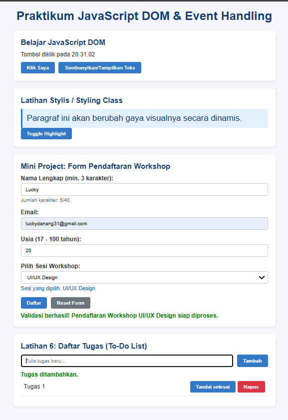

# Laporan Praktikum 6: JavaScript DOM dan Event Handling
**Nama:** Lucky Danang Aryeswara  
**NIM:** 312510482  
**Mata Kuliah:** Pemrograman Web    
**Pertemuan:** 7  
**Topik:** JavaScript DOM dan Event Handling

---

### 1. Apa yang dimaksud dengan DOM dan apa manfaatnya?

**Document Object Model (DOM)** adalah antarmuka pemograman (*application programming interface* / API) standar yang merepresentasikan struktur dokumen HTML atau XML sebagai sebuah pohon objek (*object tree*). 

Dalam konsep DOM, setiap bagian dari halaman web (elemen HTML, teks, atribut, hingga komentar) dianggap sebagai **simpul (*node*)** atau **objek** yang dapat diakses, dipanipulasi, dan diubah.

**Manfaat DOM:**
* **Interaktivitas Dinamis:** Memungkinkan bahasa pemrograman skrip seperti JavaScript untuk mengubah konten, struktur, dan gaya CSS halaman web secara real-time tanpa perlu memuat ulang (*reload*) halaman.
* **Respon Event:** Memungkinkan aplikasi web untuk merespons berbagai tindakan pengguna (seperti klik mouse, ketikan keyboard, pergerakan kursor, atau pengiriman form).
* **Manipulasi Elemen:** Memudahkan proses penambahan, penghapusan, atau pembaruan elemen HTML dan atributnya berdasarkan kondisi tertentu.

---

### 2. Apa perbedaan `getElementById()`, `querySelector()`, dan `querySelectorAll()`?
IT 
Ketiga fungsi tersebut digunakan untuk memilih elemen HTML pada DOM, namun memiliki perbedaan mendasar dari cara kerja dan output yang dihasilkan:

| Metode | Deskripsi | Argumen/Parameter | Output |
| :--- | :--- | :--- | :--- |
| **`getElementById()`** | Memilih satu elemen spesifik berdasarkan nilai unik dari atribut `id`. | String berupa nama ID saja (contoh: `"judul"`). | Satu objek `Element` (atau `null` jika tidak ditemukan). |
| **`querySelector()`** | Memilih **elemen pertama** yang cocok dengan selector CSS tertentu. | String selector CSS (contoh: `"#judul"`, `".pesan"`, `"div > p"`). | Satu objek `Element` pertama yang cocok (atau `null`). |
| **`querySelectorAll()`** | Memilih **semua elemen** yang cocok dengan selector CSS tertentu. | String selector CSS (contoh: `".item"`, `"input[type='text']"`). | Kumpulan elemen berupa **`NodeList`** (mirip *array*). |

---

### 3. Apa fungsi `addEventListener()` dan sebutkan tiga contoh event?

**Fungsi `addEventListener()`:**  
`addEventListener()` adalah metode dalam JavaScript yang digunakan untuk mendaftarkan atau menghubungkan suatu penangan event (*event listener/handler*) ke sebuah elemen HTML. Ketika kejadian/event tertentu terjadi pada elemen tersebut, fungsi pemanggil (*callback function*) yang telah ditentukan akan dieksekusi secara otomatis.

**Tiga Contoh Event:**
1. **`click`**: Dipicu ketika pengguna menekan dan melepaskan tombol mouse (atau mengetuk pada layar sentuh) pada suatu elemen (contoh: mengklik tombol).
2. **`submit`**: Dipicu ketika formulir (`<form>`) dikirimkan oleh pengguna (misalnya menekan tombol "Daftar" atau menekan `Enter`).
3. **`input`**: Dipicu secara *real-time* ketika nilai dari elemen `<input>`, `<textarea>`, atau `<select>` mengalami perubahan atau saat pengguna mengetikkan teks.

---

### 4. Mengapa `event.preventDefault()` digunakan pada event submit form?

Secara *default*, ketika event `submit` terjadi pada formulir HTML, browser akan menjalankan aksi bawaan berupa:
1. Mengirimkan data form ke URL tujuan (atribut `action`).
2. Memuat ulang (*refresh*) atau berpindah dari halaman web saat ini.

**Alasan penggunaan `event.preventDefault()`:**
* **Mencegah Reload Halaman:** Menghentikan proses pemuatan ulang browser sehingga keadaan (*state*) aplikasi web saat ini tidak hilang.
* **Memberikan Waktu Validasi Client-Side:** Memungkinkan skrip JavaScript untuk memeriksa/memvalidasi data input pengguna terlebih dahulu (seperti memeriksa kolom kosong, format email, atau batasan nilai).
* **Pengiriman Asinkron (AJAX/Fetch):** Memungkinkan pengiriman data ke server secara latar belakang (*background request*) tanpa mengganggu tampilan antarmuka yang sedang aktif.

---

### 5. Apa perbedaan `textContent` dan `innerHTML` dari sisi penggunaan dan keamanan?

`textContent` dan `innerHTML` sama-sama digunakan untuk membaca atau mengubah isi dari sebuah elemen DOM, tetapi memiliki perbedaan krusial:

#### A. Dari Sisi Penggunaan:
* **`textContent`**: Hanya membaca atau menyisipkan **teks murni** (*plain text*). Semua tag HTML yang dimasukkan akan di-encode dan ditampilkan sebagai karakter teks biasa tanpa diproses sebagai sintaks markup.
* **`innerHTML`**: Membaca atau menyisipkan **markup HTML**. Karakter tag HTML yang dimasukkan akan diparsing dan dirender oleh browser sebagai elemen HTML sungguhan.

#### B. Dari Sisi Keamanan:
* **`textContent` (Aman):** Sangat aman digunakan untuk menampilkan data/input dari pengguna karena mencegah eksekusi skrip berbahaya.
* **`innerHTML` (Beresiko / Rentan Celah Keamanan):** Memiliki risiko tinggi terhadap serangan **XSS (Cross-Site Scripting)** jika memasukkan teks pengguna (*untrusted user input*) tanpa sanitasi, karena penyerang dapat menyisipkan tag `<script>` atau tag dengan event handler berbahaya (seperti ``).

---

### 6. Bagaimana `classList.toggle()` membantu mengubah tampilan elemen?

Metode `classList.toggle('nama-kelas')` bekerja dengan cara mengecek keberadaan suatu kelas CSS pada daftar kelas (`classList`) sebuah elemen:
* Jika kelas CSS **belum ada**, `toggle()` akan **menambahkannya**.
* Jika kelas CSS **sudah ada**, `toggle()` akan **menghapusnya**.

**Kemudahan yang diberikan:**
* **Efisiensi Kode:** Menghilangkan kebutuhan penulisan percabangan `if-else` manual yang rumit untuk memeriksa kondisi elemen menggunakan `classList.contains()`, `classList.add()`, atau `classList.remove()`.
* **Interaktivitas UI:** Sangat berguna untuk mengubah antarmuka pengguna secara fleksibel, seperti tombol pembalik tema (*dark mode/light mode*), membuka-tutup menu navigasi (*accordion/dropdown*), atau memberikan penekanan/efek visual (*highlight*) saat elemen interaktif diklik.

---

### 7. Sebutkan minimal tiga skenario pengujian validasi form!

Untuk memastikan validasi formulir berjalan sesuai harapan, berikut 3 skenario pengujian yang dapat dilakukan:

1. **Skenario Input Kosong (*Empty Fields Test*):**
   * **Tindakan:** Mengklik tombol *submit* tanpa mengisi kolom masukan apapun (misal: Nama, Email, dan Usia kosong).
   * **Ekspektasi:** Pengiriman dibatalkan dan muncul pesan kesalahan spesifik seperti *"Nama wajib diisi"*.

2. **Skenario Format Email Tidak Valid (*Invalid Email Format Test*):**
   * **Tindakan:** Memasukkan string yang tidak memenuhi pola alamat email yang benar pada kolom email (misal: `user@`, `user.com`, atau `user@domain`).
   * **Ekspektasi:** Sistem menolak form dan menampilkan peringatan *"Masukkan email yang valid"*.

3. **Skenario Batasan Angka / Nilai di Luar Jangkauan (*Out of Range / Length Test*):**
   * **Tindakan:** Memasukkan angka usia di bawah 17 tahun (misal: `15`) atau di atas 100 tahun pada kolom usia.
   * **Ekspektasi:** Validasi memblokir pengiriman formulir dan menampilkan instruksi *"Usia harus berupa bilangan bulat 17-100"*.